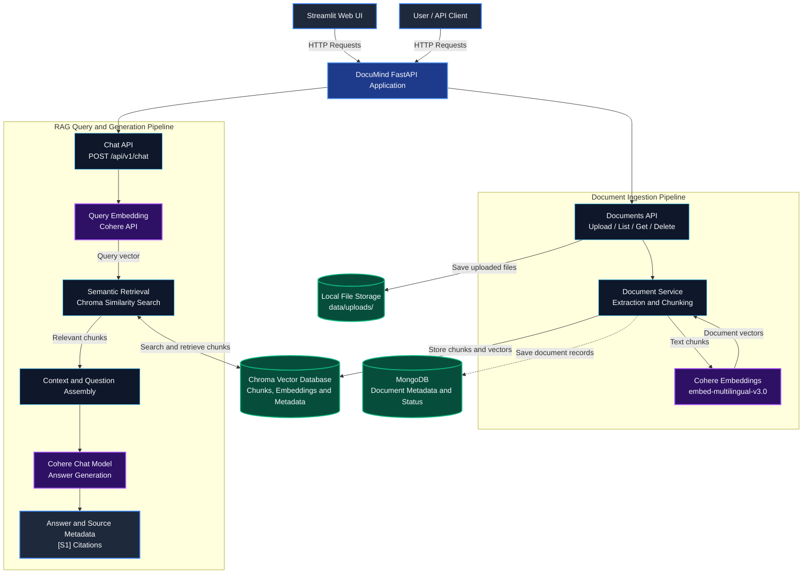
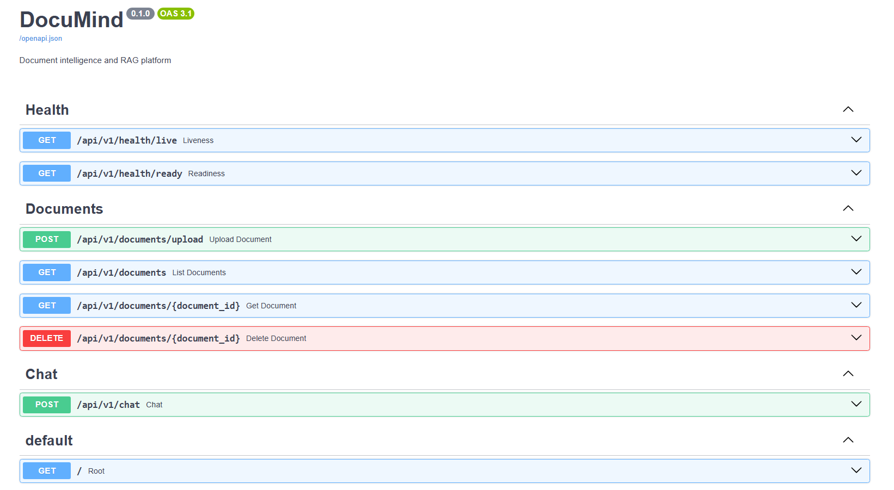
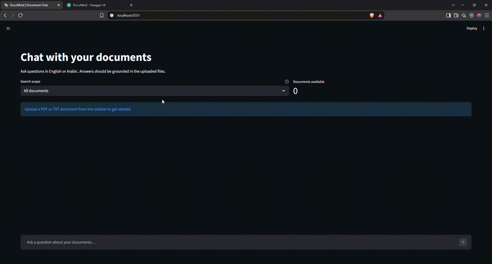

# DocuMind — Bilingual RAG Document Assistant

DocuMind is a document-question-answering application built with **FastAPI, MongoDB, Chroma, and Cohere**. It ingests user-provided documents, splits their content into chunks, generates multilingual embeddings through Cohere, retrieves relevant chunks from Chroma, and uses a hosted Cohere chat model to generate answers with source references.

The project supports **English and Arabic documents and question answering**.

## Key Features

| Feature | Details |
| :--- | :--- |
| **LLM Provider Support** | Cohere API (embeddings & generation)  |
| **Vector Database** | Chroma — lightweight embedded vector store for semantic retrieval |
| **Document Processing** | Support for PDF, DOCX, TXT, and Markdown (`.md`) files with text extraction and chunking |
| **Bilingual Support** | English and Arabic  document ingestion and question-answering capabilities |
| **Source Tracking** | Returns source metadata including document ID, filename, page, chunk index, and retrieval distance |
| **API Management** | Document upload, inspection, listing, deletion, and chat routes via FastAPI |
| **Configuration** | Pydantic Settings for environment-based parameter management |
| **Web Interface** | Streamlit UI for document upload, listing, deletion, RAG chat, and viewing answer sources and citations |

## Tech Stack

### Frontend
- **Streamlit** — Interactive web interface for document management and RAG question answering
- **Requests** — HTTP communication between the Streamlit frontend and FastAPI backend

### Backend
- **FastAPI** — REST API framework
- **Pydantic Settings** — environment-based configuration

### AI / ML
- **Cohere API** — hosted multilingual embeddings (`embed-multilingual-v3.0`) and answer generation

### Vector Databases & Storage
- **Chroma** — vector storage and semantic retrieval
- **MongoDB** — document metadata and ingestion status

### Infrastructure
- **Docker Compose** — local MongoDB and Chroma services

---

## Architecture




---

## Project Structure

```text
DocuMind/
├── app/
│   ├── api/
│   │   └── routes/
│   │       ├── data.py
│   │       ├── health.py
│   │       └── chat.py
│   ├── core/
│   │   └── config.py
│   ├── db/
│   │   └── mongodb.py
│   ├── providers/
│   │   ├── base.py
│   │   ├── cohere_provider.py
│   │   └── factory.py
│   ├── schemas/
│   │   ├── document.py
│   │   └── chat.py
│   ├── services/
│   │   └── document_service.py
│   └── main.py
├── rag/
│   ├── generation/
│   │   └── generator.py
│   ├── ingestion/
│   │   ├── embedder.py
│   │   ├── loader.py
│   │   └── splitter.py
│   └── retrieval/
│       └── retriever.py
├── data/
│   └── uploads/
├── frontend/
│   └── streamlit_app.py
├── .env.example
├── .gitignore
├── docker-compose.yml
├── requirements.txt
└── README.md
```

---

## Setup

### 1. Requirements

- Python 3.11
- Conda
- Docker Desktop with Docker Compose
- A Cohere API key with access to the configured embedding and chat models

### 2. Create and Activate the Environment

From the project root in PowerShell:

```powershell
conda create --name DocuMind python=3.11 -y
conda activate DocuMind
python -m pip install -r requirements.txt
```

### 3. Configure Environment Variables

Copy `.env.example` to `.env` and provide values appropriate for your machine and MongoDB setup. At minimum, configure the MongoDB connection and Cohere API key.

Relevant settings include:

```dotenv
LLM_PROVIDER=cohere
COHERE_API_KEY=your_cohere_api_key
COHERE_EMBEDDING_MODEL=embed-multilingual-v3.0
COHERE_GENERATION_MODEL=command-a-plus-05-2026
CHROMA_COLLECTION=documind_chunks
CHUNK_SIZE=800
CHUNK_OVERLAP=120
RETRIEVAL_TOP_K=5
RETRIEVAL_MAX_DISTANCE=0.65
```

### 4. Start the Database Services

```powershell
docker compose up -d
```

Check service status with:

```powershell
docker compose ps
```

### 5. Run the API

```powershell
python -m uvicorn app.main:app --reload
```

Open the Swagger UI at <http://127.0.0.1:8000/docs>.

---

### 6. Run the Streamlit Web Interface

Keep the FastAPI backend running in the first terminal. Open a second PowerShell terminal and run:

```powershell
conda activate DocuMind
cd D:\Projects\DocuMind
python -m streamlit run frontend/streamlit_app.py
```


## API Reference

Interactive documentation and testing are available via Swagger UI (`/docs`).




### Data & Chat Endpoints

| Method | Endpoint | Description |
|---|---|---|
| `GET` | `/` | Basic application information |
| `GET` | `/api/v1/health/ready` | Readiness check |
| `POST` | `/api/v1/documents/upload` | Upload and ingest a PDF, DOCX, TXT, or MD document |
| `GET` | `/api/v1/documents` | List document records |
| `GET` | `/api/v1/documents/{document_id}` | Get one document record |
| `DELETE` | `/api/v1/documents/{document_id}` | Delete a document and its indexed chunks |
| `POST` | `/api/v1/chat` | Retrieve relevant chunks and generate a RAG answer |

### Demo




---

## Current Limitations

- Retrieval has only been smoke-tested; comprehensive evaluation metrics have not yet been collected, and the distance threshold remains provisional.
- Generated source labels should be verified against retrieved passages and do not guarantee that every claim is supported.

---

## Future Work

- **Phase 1:** Stabilize RAG pipeline and edge-case handling.
- **Phase 2:** Implement RAG evaluation framework.
- **Phase 3:** Optimize retrieval quality and chunking strategy.
- **Phase 4:** Expand automated testing (`pytest`) and robust logging.
- **Phase 5:** Expand LLM provider support beyond Cohere by integrating additional hosted providers, such as OpenAI and Google Gemini.
- **Phase 6:** Add support for local LLMs through tools such as Ollama, enabling local inference and greater control over data privacy and deployment.

---

<div align="center">

### 👤 About the Developer

Designed and implemented by **Abdulrhman Hussein**
[](https://github.com/AbdulrhmanHussein)

---

**Permissions & Licensing**
Distributed under the terms of the project's [LICENSE](LICENSE) file.

</div>
